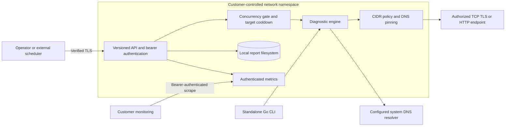
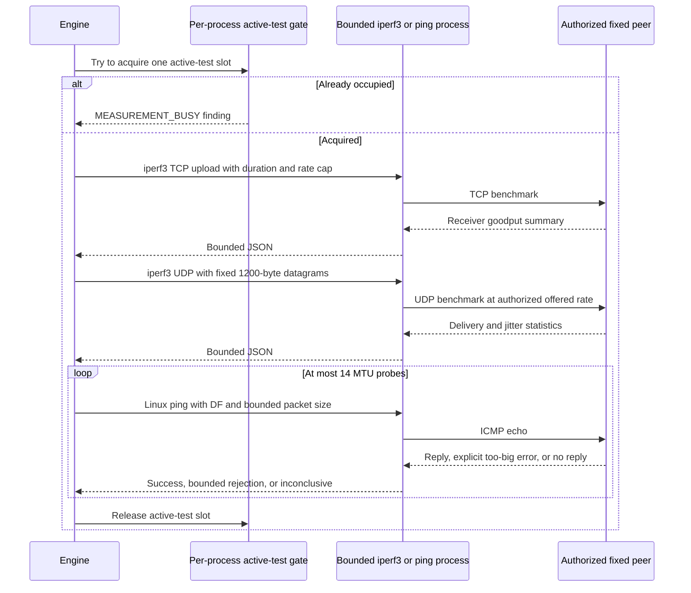
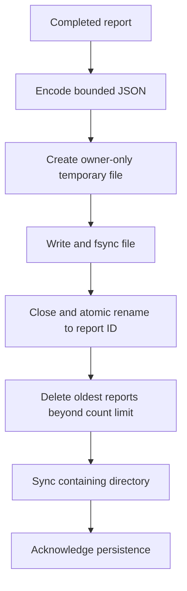
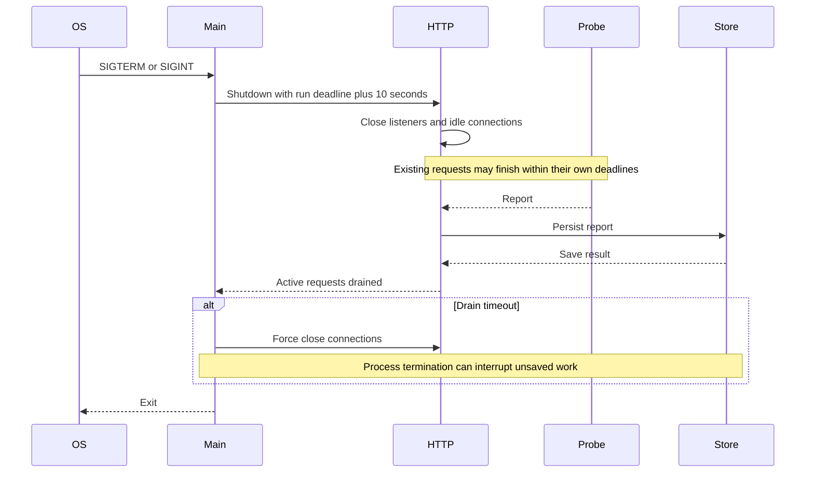

# Hybrid Net Lens: Detailed Design

## 1. Problem Statement

Applications communicate across Kubernetes networks, on-premises sites, VPNs, and
public clouds. An intermittent timeout can originate in name resolution, routing,
firewalls, TLS configuration, a reverse proxy, or the application itself. Teams
often collect inconsistent evidence from different machines and confuse a failed
connection with packet loss or a network root cause.

Hybrid Net Lens provides repeatable, authorized endpoint checks from a known
vantage point. It preserves timestamped observations and explains the next
investigation step without claiming visibility into infrastructure it cannot observe.

The initial business use is a fixed-scope connectivity assessment. Repeated
assessments can become scheduled checks using an existing scheduler and monitoring
stack. Faster investigation is the proposed customer outcome; improvement must be
validated with real incidents rather than assumed from the existence of a tool.

## 2. Goals and Non-Goals

### Goals

- Run without root, host networking, packet interception, or a privileged CNI.
- Offer a standalone JSON CLI and an authenticated versioned HTTP API.
- Bound diagnostic time, concurrency, destinations, response headers, and storage.
- Preserve evidence with explicit failures and recommendations.
- Make failures, limitations, and deployment responsibilities visible.
- Support Linux production deployment and macOS local development in Go.

### Non-Goals for This Release

No software MRC transport, SRv6 overlay, RoCE interception, packet spraying, network
configuration changes, application traffic capture, or guaranteed root-cause analysis.
No passive packet-loss measurement or traceroute. Active UDP delivery loss,
rate-capped upload throughput, and Linux DF MTU checks are opt-in. No built-in scheduler,
cross-agent correlation, SaaS control plane, identity federation, RBAC, billing,
UI, HA, or notification delivery.

## 3. High-Level Architecture



An agent observes only its own network namespace. A Kubernetes pod may have
different routes, policy, DNS, or service-mesh behavior from another pod or a node.
Deploy deliberately at each relevant vantage point. There is no central
orchestrator and no implicit access to cluster or cloud APIs.

### Package Responsibilities

| Package | Responsibility |
| --- | --- |
| `cmd/hybrid-net-lens` | Command parsing, config loading, secrets, lifecycle, TLS server |
| `internal/config` | Strict JSON schema validation and outbound address policy |
| `internal/diagnostic` | Bounded probes, evidence, findings, report status |
| `internal/store` | Atomic report files, owner-only permissions, reads, retention |
| `internal/api` | Authentication, request admission, routes, metrics, request logs |

Only the Go standard library is required for application code. Baseline checks
run in process. Opt-in active checks execute fixed `iperf3`/`ping` binaries with
argument arrays, context deadlines, bounded output, a sanitized environment, and
no shell. There are no cloud SDK credentials or Kubernetes API permissions.

## 4. Configuration and Trust Model

Configuration is operator-controlled, loaded once at startup, and validated before
serving traffic. Client input contains only a configured target ID. It cannot
select a new hostname, port, protocol, URL, resolver, command, or CIDR.

The API is single-tenant. A bearer token authorizes all targets, reports, and
metrics in one deployment. Separate customers or trust domains require separate
deployments, tokens, volumes, and network policies. A shared token is not RBAC.

Secrets come from an environment variable or a mounted token file, never JSON
config. The service hashes both configured and supplied tokens with SHA-256 and
compares the fixed-length hashes using constant-time comparison. TLS protects
the token in transit; random token generation remains the operator's responsibility.

The process has network access to DNS resolvers and configured endpoints. Endpoint
policy does not restrict the resolver's address, so DNS egress must be controlled
separately. The report directory and all parent directories must be trusted and
must not be concurrently modified by untrusted processes.

## 5. Destination Safety

For each run:

1. Parse a configured IP literal or resolve its hostname once using Go's resolver
   and a per-operation context deadline.
2. Normalize IPv4-mapped IPv6 addresses, deduplicate, and sort answers.
3. Reject zero answers or more than 16 unique addresses.
4. Validate **every** answer before opening any connection. Any denied answer
   fails the entire target rather than silently selecting a permitted subset.
5. Reject unspecified, link-local, multicast, limited-broadcast, and explicitly
   blocked cloud metadata/platform addresses, regardless of CIDR configuration.
6. Require an explicit matching IPv4 or IPv6 CIDR. Universal `/0` networks and
   IPv4-mapped IPv6 prefixes are rejected.
7. Dial numeric validated IPs only. Preserve the configured hostname for TLS SNI,
   certificate validation, and the HTTP Host header.
8. Disable HTTP environment proxies, redirects, connection reuse, compression,
   cookies, and response-body collection.

This resists arbitrary-destination requests, common metadata SSRF, and DNS
rebinding between validation and connection. It does not prove target ownership,
control the physical path, account for every provider-specific metadata alias, or
replace egress enforcement. A malicious authorized endpoint can still consume
resources up to configured deadlines. A misconfigured broad CIDR remains risky.

## 6. Diagnostic Execution

Each run has a parent deadline, bounded by 120 seconds. DNS, each TCP connect,
each TLS handshake, and each HTTP request also have individual deadlines. Work
is sequential within a run; API runs may execute concurrently up to the configured
limit. There is no waiting job queue.

Each validated address receives `attempts` TCP connection checks. If any connect
succeeds, TLS targets receive one verified handshake; HTTP targets receive one
GET; HTTPS targets receive a handshake check followed by a separately connected
HTTPS GET. These observations are not one persistent application session.

```mermaid
sequenceDiagram
    participant Client
    participant API
    participant Gate as Admission gate
    participant Engine
    participant DNS
    participant Target
    participant Disk as Report store
    Client->>API: POST /api/v1/runs with bearer and target_id
    API->>API: Authenticate and strictly validate bounded JSON
    API->>Gate: Acquire slot and check target cooldown
    alt Capacity exhausted or cooldown active
        Gate-->>API: Reject immediately
        API-->>Client: 429 with Retry-After
    else Admitted
        API->>Engine: Run with request context and whole-run deadline
        Engine->>DNS: Resolve configured host with deadline
        DNS-->>Engine: Address set or resolution error
        Engine->>Engine: Normalize and validate every destination
        alt DNS failure or denied address
            Engine-->>API: Failed evidence report
        else Authorized addresses
            loop Each address and TCP attempt
                Engine->>Target: TCP connect to pinned IP
                Target-->>Engine: Connect result and timing
            end
            opt TLS or HTTPS with reachable address
                Engine->>Target: TLS handshake with hostname verification
                Target-->>Engine: Handshake result
            end
            opt HTTP or HTTPS with prior checks successful
                Engine->>Target: GET health path without redirects
                Target-->>Engine: Response headers and status
            end
            Engine-->>API: Completed or incomplete report
        end
        API->>Disk: Save, sync, rename, prune, directory sync
        alt Storage success
            Disk-->>API: Persisted
            API-->>Client: 201 with report and Location
        else Storage failure
            Disk-->>API: Error
            API-->>Client: 503; report acknowledgement withheld
        end
        API->>Gate: Release slot
    end
```

The cooldown is five seconds between starts for the same target and is in-memory.
A long run can overlap another run of the same target after the cooldown if
global capacity is available. External schedulers should prevent unwanted overlap.
Cooldowns reset after restart. API POSTs have no idempotency key: a lost response
and retry can create another report. Check recent reports before retrying.

Client disconnect cancels outstanding probes; the API still attempts to preserve
the resulting incomplete report. The client might never receive its ID. A CLI
run prints its report only and never uses the persistent store.

## 7. Evidence and Findings

### Active Measurement Contract

The optional `target.measurements` object is an additive configuration/report
extension. Its absence preserves the original behavior. It requires an IP literal
peer, the normal all-answer address policy, explicit feature booleans, and traffic
budgets. Startup preflight rejects missing binaries and MTU on non-Linux platforms.
Removing the object disables the feature without touching existing reports.



One active test set runs at a time per process to reduce self-interference. An
iperf3 process has a deadline of test duration plus the configured connect timeout
plus three seconds, always under the run deadline. Its JSON stdout is capped at
1 MiB, stderr at 16 KiB, and process I/O shutdown at one second. API secrets and
loader-related environment variables are not inherited. Failed tools do not
produce fabricated zero-bandwidth or zero-loss results.

Throughput is receiver-observed upload goodput under a 1..20 Mbps cap for 1..10
seconds. It is not an uncapped capacity measurement. At the maximum settings,
each benchmark targets roughly 25 MB payload, plus overhead and any retransmission;
TCP and UDP together target roughly 50 MB. Rate pacing is not a strict byte quota.
UDP loss reports lost datagrams divided by receiver-reported total datagrams,
plus jitter, offered rate, and 1200-byte payload size. Network, sender, and receiver
resource limitations can all affect delivery loss.

MTU probing uses Linux iputils ping datagram sockets, with `-M do`, one echo per
size, fixed IPv4/IPv6 overhead, and binary search within 1280..9000 bytes. It first
requires a successful minimum-sized echo. Only explicit too-big/fragmentation
errors reduce the upper bound. Missing replies stop the search as inconclusive.
Results carry largest confirmed size, optional smallest rejected size, ceiling,
probe count, and `lower_bound`, `bounded_estimate`, or `inconclusive` confidence.
ECMP, encapsulation, ICMP policy, and route changes prevent a universal path-MTU
guarantee. No conclusion is drawn from timeout alone.

The container strips ping's file capability; otherwise `cap-drop=ALL` can prevent
execution before ping starts. Linux `ping_group_range` authorizes GID 10001 for
datagram ICMP. iperf3 needs temporary backing files, so the chart provides a 16 MiB
memory-backed `/tmp`, while the root filesystem stays read-only. These behaviors
are exercised by actual container and Cilium-backed Kubernetes tests.

Report schema version `1` contains:

- A random 128-bit hex ID and the agent hostname as `vantage`.
- A copy of the configured target, UTC start/end times, and final status.
- Per-phase measurements: address, TCP attempt, elapsed milliseconds, success,
  error text, resolved address set, and HTTP status where applicable.
- Findings with stable code, severity, evidence, and recommended investigation.

| Finding | Observation and interpretation |
| --- | --- |
| `DNS_FAILED` | Resolver returned an error; not proof of a DNS infrastructure outage |
| `ADDRESS_DENIED` | Answers are empty/excessive or violate destination policy |
| `TCP_UNREACHABLE` | All completed connects failed for one address |
| `TCP_INTERMITTENT` | Some completed connects failed; not a packet-loss statistic |
| `TLS_FAILED` | Verified TLS handshake failed; inspect certificate and connectivity evidence |
| `HTTP_FAILED` | Request failed or status differed from the configured expected value |
| `RUN_INCOMPLETE` | Deadline or cancellation prevented a complete assessment |
| `MEASUREMENT_BUSY` | Another active test owns the per-process measurement slot |
| `MEASUREMENT_FAILED` | Benchmark tool, peer, budget, or deadline failed; no result inferred |
| `UDP_DELIVERY_LOSS` | Receiver reported datagrams lost at the configured offered rate |
| `MTU_INCONCLUSIVE` | Permissions, platform, ICMP policy, or replies did not support an estimate |

Status is `healthy` without findings, `degraded` for warning-only findings,
`failed` with error findings, or `incomplete` if the run context was canceled or
expired. Incomplete reports must not be interpreted as fully tested failures or
successes. A failed address makes the overall target unhealthy even if another
address worked. Small sample counts are not statistically significant reliability
estimates, and connect time is not a network RTT measurement.

No HTTP bodies, packet payloads, application credentials, or traffic captures are
stored. Hostnames, IPs, certificate errors, and resolver errors can still be
sensitive. Treat reports and their backups accordingly.

## 8. Persistence and Retention



The data directory must be mode 0700, and report files are created as 0600.
Final filenames accept exactly 32 lowercase hexadecimal characters plus `.json`.
Reads reject symlinks, non-regular files, oversize files, trailing JSON, mismatched
IDs, and unsupported schema versions. The directory is an operator-owned trust
boundary, not a defense against a malicious process running as the same UID.

A mutex serializes store operations inside one process. Local file and directory
sync are required. Do not use multiple processes or replicas against the same
directory, and do not assume remote object/NFS storage has equivalent semantics.
The deployment uses `Recreate` and one replica to avoid concurrent writers.

Retention is count-based, ordered by file modification time with filename tie
breaking. Listing returns at most 100 newest summaries and does not paginate the
entire archive. Saving scans/sorts directory metadata; the design favors modest
retention (for example 1000), not a high-volume analytics database. Raising the
limit requires measuring filesystem latency and memory overhead.

Each encoded report is limited to 1 MiB. Temporary files may remain after a crash.
Readiness writes and syncs a temporary marker to check basic storage health;
readiness does not certify every historic report or a remote target's health.

If pruning or directory sync fails after rename, the report might exist even
though the API returns 503. This is deliberate conservative acknowledgement, not
an exactly-once transaction. Retention deletion is not archival and needs backups
if recovery is required.

## 9. API and Observability

The `/api/v1` prefix is the compatibility boundary. Changes should be additive;
semantic breaking changes need a new API version and migration period. Persisted
reports have a separate schema version. Do not modify stored version-1 semantics
in place or silently migrate files during rollback.

The HTTP server bounds header size, header/body read time, idle time, write time,
and POST body size. Protected routes require a bearer token; health endpoints are
unauthenticated and must still be network-restricted. Metrics share the API token.

Structured request logs contain method, matched route, status, elapsed time, and
generated request ID, not raw URLs, request bodies, or authorization headers.
Diagnostic completion logs include report ID, target ID, and final status. No
external telemetry backend is contacted.

Prometheus metrics:

| Metric | Meaning |
| --- | --- |
| `hybrid_net_lens_requests_total` | HTTP requests, including health and metrics |
| `hybrid_net_lens_runs_total` | Diagnostic executions started |
| `hybrid_net_lens_active_runs` | Admitted requests still executing/persisting |
| `hybrid_net_lens_storage_errors_total` | Failed report saves |
| `hybrid_net_lens_last_run_healthy{target_id}` | Latest persisted result: 1 healthy, otherwise 0 |
| `hybrid_net_lens_last_run_timestamp_seconds{target_id}` | Completion time for that result |

All metrics are in-memory and reset at restart. Target labels come only from the
bounded configuration, never arbitrary client data. Last-result series are absent
until a new run is saved. Monitor missing/stale series as well as failed results.
Metrics are not an audit ledger. Durable report files provide run history, subject
to retention.

## 10. Lifecycle and Deployment



No privileges, capabilities, host networking, service-account token, or Kubernetes
RBAC are required. The sample container runs as UID/GID 10001 with a read-only
root filesystem. The PVC must permit that UID to create an owner-only report
subdirectory; storage drivers must support the relevant fsGroup semantics.

Production ingress should use verified TLS directly or a trusted TLS proxy with
the plaintext hop isolated. The sample Kubernetes service uses direct TLS and
restrictive ingress/egress policies. DNS placement, endpoint CIDRs, image registry,
storage class, secret provisioning, certificate SANs, and monitoring access are
deployment-specific and must be reviewed before installation.

Scheduling is intentionally external. A recurring assessment can call the API
and archive its JSON, or invoke the local CLI and use its exit code. Avoid
overlapping runs and configure client timeouts above the diagnostic deadline.

## 11. Failure Handling and Recovery

| Failure | Behavior |
| --- | --- |
| Invalid config or missing/weak token | Refuse startup |
| Non-loopback plaintext without override | Refuse startup |
| Unknown/extra POST fields or destination | Reject before probing |
| Capacity/cooldown limit | 429, no queued work |
| DNS/policy failure | Evidence report, no target connections |
| TLS trust/hostname failure | Fail handshake; do not bypass verification |
| Request deadline/disconnect | Cancel probes; attempt incomplete-report persistence |
| Disk full, permissions, sync failure | 503, increment save-error metric |
| Readiness storage check failure | 503 on `/readyz` |
| Process crash | Existing final reports remain; active work may be lost |
| Corrupt historic report | Read/list failure; operator must investigate, not silently skip |

Before upgrading, stop the service and snapshot reports plus config. To roll back,
restore the prior compatible image/config and restart. This version performs no
schema migration. Future incompatible report formats require a version gate and
explicit reversible migration strategy. Restoring old data can lose newer reports;
retain a copy before doing so. Deleted retained reports are recoverable only from
backups. Token/certificate rotation currently requires a coordinated restart.

## 12. Verification Strategy

- Configuration tests cover malformed input, invalid fields, bounds, CIDRs,
  reserved addresses, and duplicate target IDs.
- Local probe tests cover successful HTTP, unexpected status, redirect refusal,
  DNS failure, all-answer policy enforcement, pinned dialing, untrusted TLS,
  timeouts, and cancellation.
- Store tests cover concurrent access, reopening, retention, permissions, invalid
  IDs, trailing data, and symlink rejection.
- API tests cover authentication, health, report creation/read/list, cooldown,
  admission limits, malformed/oversize input, metrics, and save failures.
- CLI tests cover listener safety, token sources, and command errors.
- CI runs race-enabled tests, vet, formatting verification, binary compilation,
    configuration validation, reachable Go vulnerability scanning, a container
    build/security scan, real container measurements, and isolated Kubernetes checks.

### Recorded Release Evidence

Release `0.2.0` was validated on 2026-10-26 with:

| Gate | Observed result |
| --- | --- |
| Go 1.26.10 unit tests, race detector, vet, formatting | Passed |
| govulncheck v1.1.4 reachable-code scan | No vulnerabilities found |
| Digest-pinned builder/runtime images | Image build and version command passed |
| Digest-pinned Trivy scan | Zero fixable HIGH/CRITICAL findings in Debian packages and Go binary |
| Real non-root, read-only, capability-dropped container | Trusted TLS, auth, TCP, throughput, UDP delivery loss, MTU, token redaction, and restart persistence passed |
| Kubernetes 1.32.2 with Cilium 1.18.3 | Helm rollout, trusted TLS, active measurements, allowed/denied ingress and egress, and PVC restart persistence passed |

The Trivy policy excludes unfixed and lower-severity findings; it is not an
unqualified zero-vulnerability certification. The separate Go scan does not use
that severity filter. The test harness creates an ephemeral CA and random token,
uses a dedicated kubeconfig, refuses non-test contexts, and deletes the isolated
cluster. Production targets, PKI, tokens, registry credentials, storage, and SLO
acceptance remain explicit operator inputs. No existing AKS resources were changed.

These checks are a baseline, not production certification. Release gates also
include representative load, disk exhaustion/fault injection, termination tests,
cluster-specific NetworkPolicy/PVC validation, certificate lifecycle checks,
vulnerability scanning, verified image/action pinning, and a restore drill. Real
WAN behavior and commercial value require customer pilots.

## 13. Extension Roadmap

Add capabilities only after customer evidence identifies a repeated need:

1. Signed report export and comparison across independently deployed agents.
2. Controlled MTU/throughput tests with explicit peer cooperation and traffic budgets.
    Implemented as optional iperf3/DF checks; future work includes richer peer
    identity and test coordination rather than unrestricted traffic generation.
3. Overlapping API credentials, scoped roles, and tenant isolation before a hosted service.
4. Durable scheduling and notification delivery if existing customer tooling is insufficient.
5. A transactional database/object-store adapter before multi-replica orchestration.

Keep new active probes disabled by default or explicitly version-gated. Preserve
the existing v1 contract and report format while introducing new capabilities.